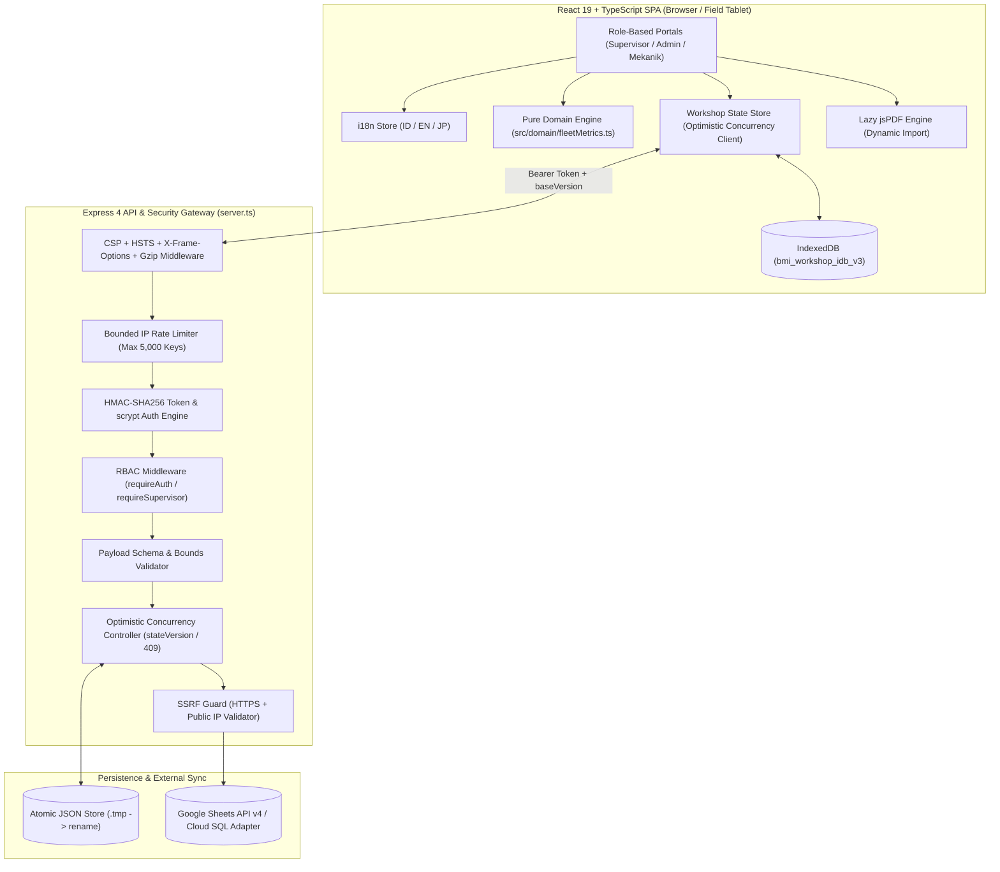

# BMI Enterprise Workshop & Fleet Management System v3.0
**物流フリート・整備工場統合管理システム (Enterprise Logistics & Fleet Maintenance DX Platform)**

[](./server.ts)
[](./src/components/ui/Modal.tsx)
[](./tests/workshop-remediation.test.mjs)
[-D19F0F)](./src/i18n/localeStore.ts)

> 🇯🇵 **日本語版ドキュメントはこちら:** [README.ja.md](./README.ja.md)

---

## 1. Executive Summary (Ringkasan Eksekutif)

**BMI Enterprise Workshop Management System v3.0** is an industrial-grade full-stack web application engineered to digitize multi-pool heavy logistics fleet maintenance (`Head Truck`, `Chassis 20ft/40ft`, `Clip-On/Undermount Genset`), **13-Point Daily Chassis Inspection (`シャーシ13項目日常点検`)**, **Tire Cost-Per-Kilometer (`CPK`) & Tread Wear Intelligence**, and **Work Order (`整備指示書`)** lifecycles across operational pools (**Surabaya, Lamongan, Dampit**).

### Key Operational & Engineering Highlights
- **Zero Silent Data Overwrite (Optimistic Concurrency Control):** State synchronization enforces monotonic `stateVersion` validation (`HTTP 409 Conflict` + automatic entity-level merge + server-side conflict snapshot backup) and atomic `.tmp` $\rightarrow$ `fs.promises.rename` persistence.
- **Defense-in-Depth Security (OWASP ASVS v4.0 Level 2):**
  - Server-authoritative authentication using `crypto.scryptSync` + `crypto.timingSafeEqual` and HMAC-SHA256 bearer tokens with server-side logout revocation.
  - Zero plaintext passwords in `localStorage` (salted multi-round one-way verifiers only).
  - Strict Role-Based Access Control (`requireAuth` & `requireSupervisor`) + SSRF protection (`validateSafeExternalAdapterUrl`) blocking RFC1918/loopback/link-local ranges.
- **Offline-Resilient Client Storage:** Asynchronous **IndexedDB** (`bmi_workshop_idb_v3`) with 400ms debounced writes replaces synchronous `localStorage` serialization bottlenecks, preventing `QuotaExceededError` on 64-tire and 13-point chassis inspection payloads.
- **Trilingual Logistics UX (`ID / EN / JP`):** Built-in localization supporting Indonesian, English, and Japanese logistics terminology (`車検 Shaken`, `日常点検 Nichijō Tenken`, `整備指示書 Seibi Shijisho`) plus **1-Click Recruiter Demo Access** with **UU PDP No. 27/2022 & Japan APPI** anonymized seed data.

---

## 2. System Architecture (Arsitektur Sistem)



---

## 3. Audit Remediation Scorecard (Before vs. After)

| Metric / Security Control | Before Audit (Baseline) | After Fase 0–3 Remediation |
| :--- | :--- | :--- |
| **Critical & High Security Findings** | 6 Critical, 8 High | **0 Critical, 0 High (100% Closed)** |
| **Password Storage (`localStorage` & Server)** | Plaintext passwords visible in DevTools & DOM | **`crypto.scryptSync` (Server) + Salted One-Way Verifier (Client)** |
| **API Endpoint Authorization** | Unauthenticated `/api/workshop/state` & `/api/config/adapter` | **`requireAuth` + `requireSupervisor` + Token Revocation** |
| **Concurrent Mechanic Edits** | Last-Write-Wins (`fs.writeFileSync` silent overwrite) | **OCC `stateVersion` (`409 Conflict` + Auto-Merge) & Atomic Rename** |
| **Client Storage Capacity** | Synchronous `localStorage` (~5 MB limit) | **Asynchronous IndexedDB (`>250 MB` capacity, 400ms debounce)** |
| **Initial PDF Bundle Impact** | Eagerly bundled `jspdf` in main entry | **Lazy Dynamic `await import('jspdf')` on Export Click** |
| **Automated Test Suite** | 0 automated tests | **34/34 Passing Automated Tests (`node --test`)** |
| **Privacy & Localization** | Real operational data only, Indonesian only | **UU PDP & Japan APPI Anonymized Demo Mode + `ID / EN / JP`** |

---

## 4. Quick Start & Verification Commands

```bash
# 1. Install dependencies
npm install

# 2. Configure environment variables
cp .env.example .env

# 3. Run the 34-test automated security, concurrency, domain & i18n suite
node --test tests/workshop-remediation.test.mjs

# 4. Start development server (Express API + Vite HMR on port 3000)
npm run dev
```
